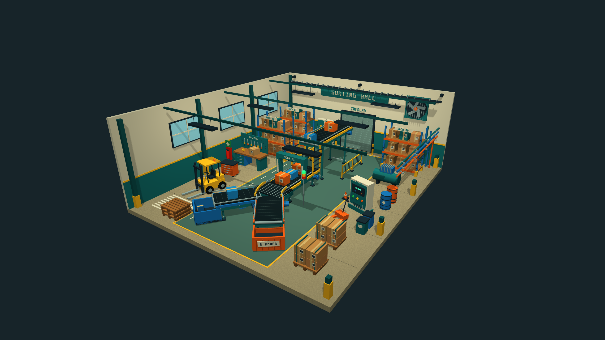
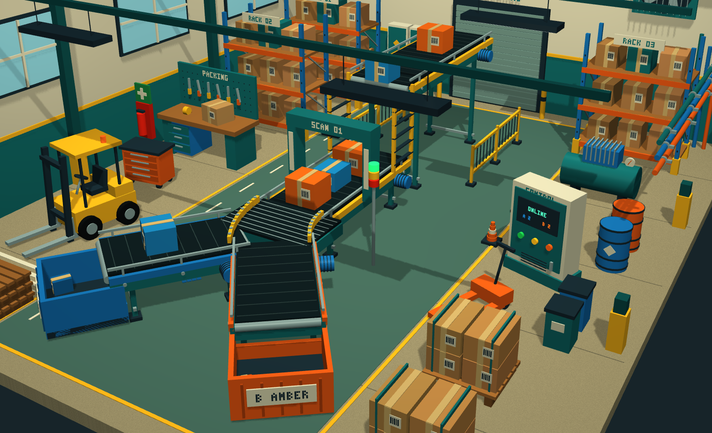
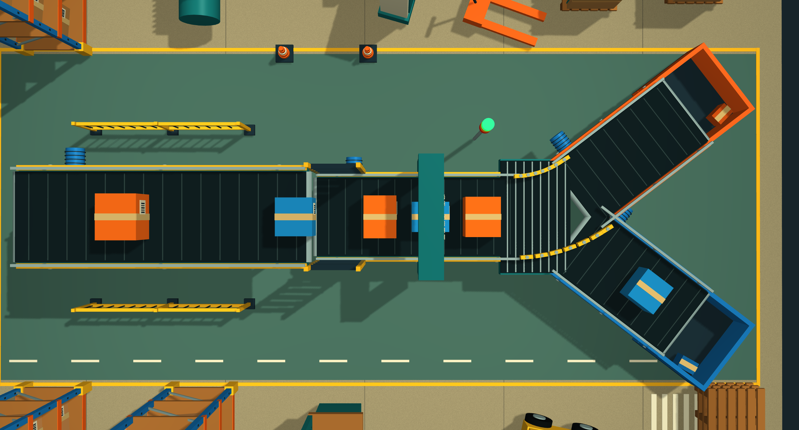
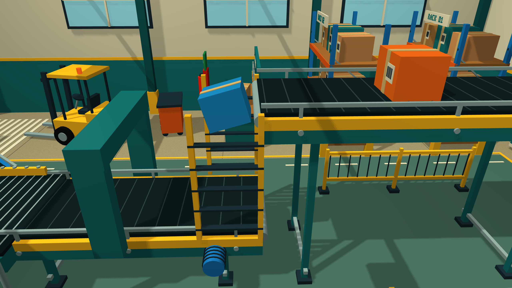
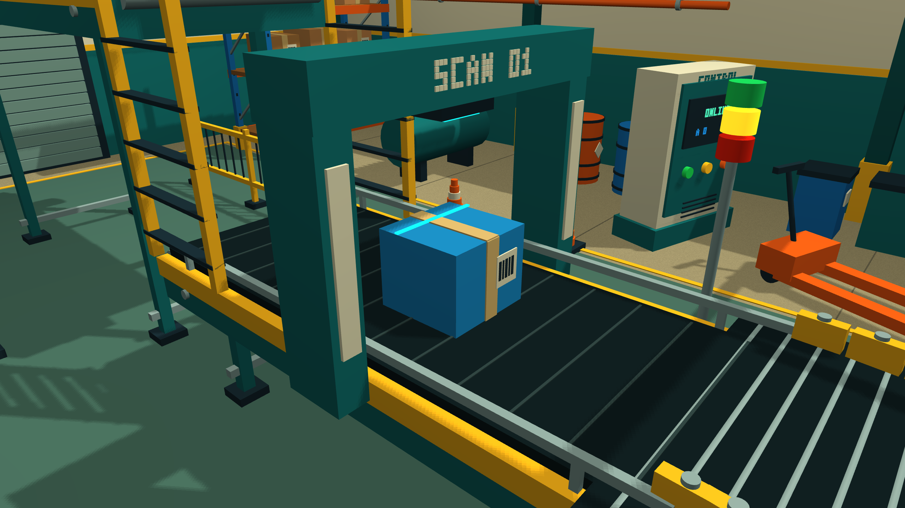
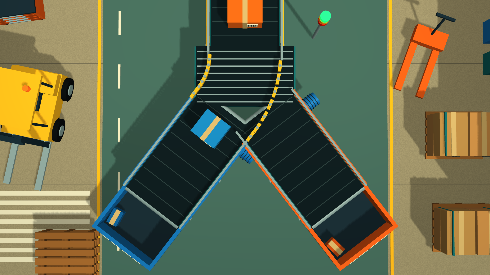

# Parcel Sorting Conveyor — OpenGL

A C++17 and OpenGL 3.3 simulation of an automated parcel-sorting factory. Parcels travel along an elevated conveyor, fall onto a lower belt, pass through a scanner, and follow a rotating gate into one of two collection lanes. The factory is built from reusable geometric primitives, without external 3D models or image textures.



[Build and run](#build-and-run) · [Controls](#controls) · [Screenshots](#screenshots) · [Project report (PDF)](docs/report/conveyor_sorting_report.pdf) · [Project structure](#project-structure) · [Documentation](docs/README.md)

## Features

- **Two-level conveyor:** gravity-driven parcel transfer with visible rotation during the fall.
- **Automatic sorting:** blue parcels follow lane A; orange parcels follow lane B. The scanner pauses each parcel before it approaches the gate.
- **Coordinated motion:** size-aware queues, a reserved sorting gate, smooth circular turns, bin landings, delivery counters, and reuse of a pool of twelve parcels.
- **Factory environment:** storage racks, labelled cartons, a forklift, pallet truck, packing bench, control cabinet, compressor, utility pipes, safety markings, and an animated ventilation fan.
- **Lighting and shading:** switchable Phong/Gouraud shading, Blinn–Phong specular highlights, attenuated overhead lights, directional daylight, and filtered shadow mapping.
- **Interactive inspection:** free-look camera, overview/top/side presets, automatic wall cutaway, pause, speed adjustment, reset, and fullscreen toggle.
- **Testable simulation:** parcel movement and routing run independently of OpenGL.

## Screenshots

These are captures of the running project. Click an image to inspect it at full resolution. Capture settings and the complete image set are in [docs/report/assets](docs/report/assets).

### Conveyor, scanner, and collection lanes



### Top view of the parcel routes



### Transfer between conveyor levels



### Scanner and gate operation

| Scanner station | Gate aligned to the left lane |
| --- | --- |
|  |  |

## Build and run

### Requirements

- A C++17 compiler: Apple Clang, GCC/Clang, or Visual Studio with the **Desktop development with C++** workload.
- CMake **3.20 or newer** and a build tool such as Make, Ninja, or MSBuild.
- Python 3 with **Jinja2**, used to generate the GLAD OpenGL loader.
- An OpenGL **3.3 Core Profile** capable graphics driver and a desktop display for running the application.
- Internet access during the first CMake configure to download dependencies.

CMake fetches **GLFW 3.3.9**, **GLM 0.9.9.8**, and **GLAD 2.0.6**, with SHA-256 verification. Downloaded libraries and generated loader files stay inside the build directory.

### Clone

```bash
git clone https://github.com/RezuanMustafaHasan/ParcelSortingCoveyorOpenGL.git
cd ParcelSortingCoveyorOpenGL
```

### macOS

Install the Xcode Command Line Tools if needed, then install CMake and Python with Homebrew:

```bash
xcode-select --install
brew install cmake python
python3 -m venv .venv
source .venv/bin/activate
python -m pip install Jinja2==3.1.6
cmake -S . -B build -DCMAKE_BUILD_TYPE=Release -DPython_EXECUTABLE="$(command -v python)"
cmake --build build --parallel
./build/conveyor_factory --windowed
```

### Ubuntu / Debian

GLFW uses X11 by default. Install the compiler and [GLFW's X11 development prerequisites](https://www.glfw.org/docs/3.3/compile.html#compile_deps_x11):

```bash
sudo apt update
sudo apt install build-essential cmake python3-venv xorg-dev libgl1-mesa-dev
python3 -m venv .venv
source .venv/bin/activate
python -m pip install Jinja2==3.1.6
cmake -S . -B build -DCMAKE_BUILD_TYPE=Release -DPython_EXECUTABLE="$(command -v python)"
cmake --build build --parallel
./build/conveyor_factory --windowed
```

### Windows — Visual Studio / PowerShell

Install CMake, Python 3, and Visual Studio with its C++ workload. From PowerShell:

```powershell
py -3 -m venv .venv
.\.venv\Scripts\python.exe -m pip install Jinja2==3.1.6
cmake -S . -B build -DPython_EXECUTABLE="$PWD/.venv/Scripts/python.exe"
cmake --build build --config Release --parallel
.\build\Release\conveyor_factory.exe --windowed
```

With MinGW, configure using `-G "MinGW Makefiles" -DCMAKE_BUILD_TYPE=Release`; the executable is then `build\conveyor_factory.exe`.

The build copies `shaders/` beside the executable automatically. macOS opens in a window by default; other platforms start fullscreen unless `--windowed` is supplied.

### Make shortcuts

After installing the requirements, macOS/Linux users can also run `make build`, `make run-windowed`, or `make test`. Pass `CMAKE_FLAGS=-DPython_EXECUTABLE=/path/to/python` if CMake needs a specific Python environment.

## Controls

| Input | Action |
| --- | --- |
| `Space` | Pause / resume the simulation |
| `+` / `-` | Increase / decrease conveyor speed |
| `R` | Reset parcels, gate, timers, delivery counts, and speed |
| `G` | Request a manual gate change; occupied gates remain interlocked |
| `L` | Toggle the overhead point lights |
| `P` | Switch Phong / Gouraud shading; Phong is the default |
| `1` / `2` / `3` | Overview / top / side camera preset |
| `W A S D` | Move the camera |
| `Q` / `E` | Move down / up |
| Mouse | Look around |
| Mouse wheel | Zoom |
| `Tab` | Release / capture the cursor |
| Left click | Recapture a released cursor |
| `F11` | Toggle fullscreen / windowed mode |
| `Esc` | Exit |

## How sorting works

Each parcel has a destination assigned when it spawns. Blue parcels go left to lane A; orange parcels go right to lane B. The scanner is a simulated checkpoint, with a 0.65-second stop and visual scan feedback.

The parcel state sequence is:

```text
Upper conveyor → Falling → Lower conveyor → Scanning → Approaching gate
  → Left or right exit → Dropping → Collected → Slot reused
```

The leading parcel reserves the gate and waits until it aligns within 0.1 degrees of its target. The gate remains locked until the parcel fully clears the guides. Parcels follow predefined curved routes rather than a contact-physics solver. Shared layout dimensions keep the rendered belts and movement paths aligned, while short simulation substeps maintain stable motion at lower frame rates.

## Tests and frame captures

```bash
ctest --test-dir build -C Release --output-on-failure
```

The existing checks cover both destinations, queue spacing, gate ownership, conveyor clearance, bin landings, pause/reset, speed changes, and repeated manual gate requests. They exercise three conveyor speeds and frame intervals from 1/144 to 1/10 second. The tests do not require a display; configuring and building the full project still requires the dependencies above.

To render a deterministic frame in a hidden window:

```bash
./build/conveyor_factory --capture build/overview.ppm --time 24 --view 1
./build/conveyor_factory --gouraud --capture build/gouraud.ppm --time 24 --view 1
```

On Visual Studio builds, use `.\build\Release\conveyor_factory.exe` instead. Captures require a working OpenGL context even though the window is hidden. The output is a PPM image; an image viewer or converter can export it as PNG. `--view` accepts `1`, `2`, or `3`, and `--time` advances the simulation by the specified number of seconds before rendering.

GitHub Actions builds the application and runs the simulation tests on Linux, macOS, and Windows. The Linux job also renders a frame using Mesa and Xvfb.

## Project structure

```text
.
├── .github/workflows/build.yml  # Build, tests, and Linux render smoke check
├── docs/
│   ├── README.md               # Documentation index
│   ├── project-specification.md
│   └── report/                 # LaTeX report, screenshots, fonts, capture tools
├── include/                    # C++ class and simulation declarations
├── shaders/                    # GLSL lighting and depth shaders
├── src/                        # Application, rendering, and simulation code
├── tests/                      # Display-independent simulation checks
├── .gitattributes              # Consistent text and binary handling
├── .gitignore                  # Build, editor, and generated-file exclusions
├── CMakeLists.txt              # Targets and pinned dependencies
├── Makefile                    # Optional macOS/Linux shortcuts
└── README.md
```

| Module | Responsibility |
| --- | --- |
| `main.cpp` | Window, input, render loop, shadow pass, and capture mode |
| `FactorySimulation` | Parcel state machine, queues, gate control, and counters |
| `FactoryScene` | Factory geometry, materials, equipment, and scene rendering |
| `Geometry` | Reusable cube and cylinder meshes |
| `Camera` | View transforms, movement, zoom, and camera presets |
| `Shader` | GLSL compilation, linking, and uniform helpers |

The published [project report PDF](docs/report/conveyor_sorting_report.pdf) is versioned with Git LFS. The report sources and original screenshots are also versioned under `docs/`. Build folders, virtual environments, other generated PDFs/presentations, and temporary captures are ignored.

## Documentation and credits

- [Documentation index](docs/README.md)
- [Original project specification](docs/project-specification.md) — proposed requirements; some differ from the final implementation.
- [Final project report (PDF, 13 pages)](docs/report/conveyor_sorting_report.pdf) — report dated 7 October 2026, stored with Git LFS.
- [Academic report and compilation instructions](docs/report/README.md)
- [Report screenshot reproduction tools](docs/report/tools/README.md)

**Author:** [Rezuan Mustafa Hasan](https://github.com/RezuanMustafaHasan) · Computer Science and Engineering, Khulna University of Engineering and Technology · CSE 4102: Computer Graphics and Image Processing.

The project uses [GLFW](https://www.glfw.org/), [GLM](https://github.com/g-truc/glm), and [GLAD](https://github.com/Dav1dde/glad). The bundled Libre Baskerville report fonts retain their [SIL Open Font License](docs/report/fonts/OFL.txt).
